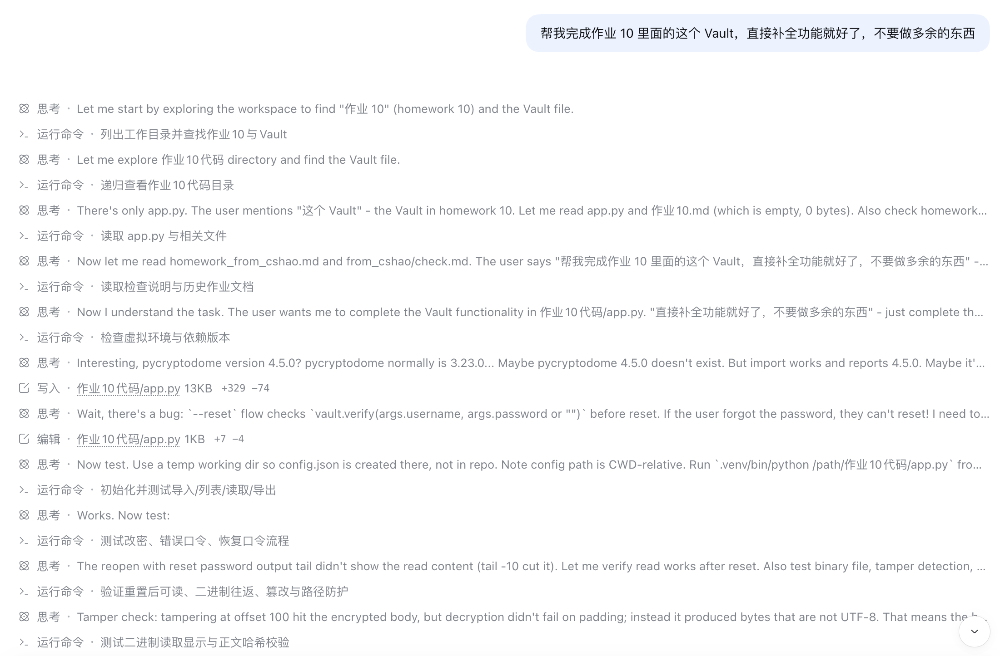
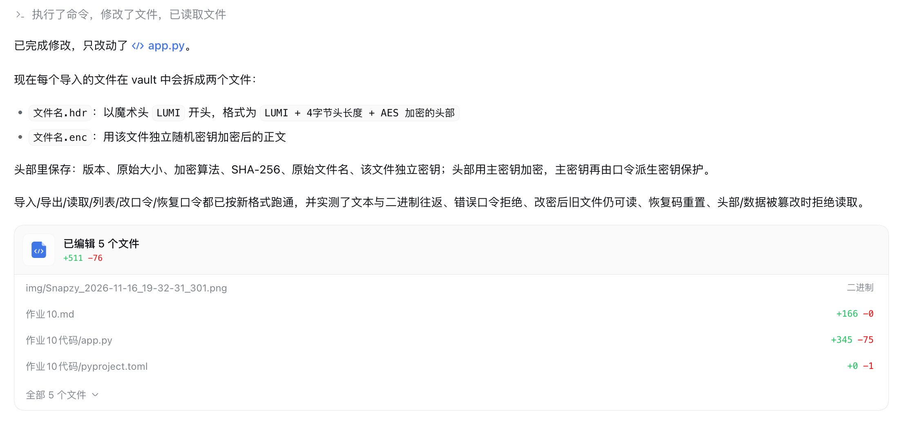
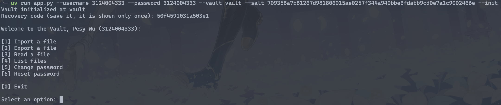
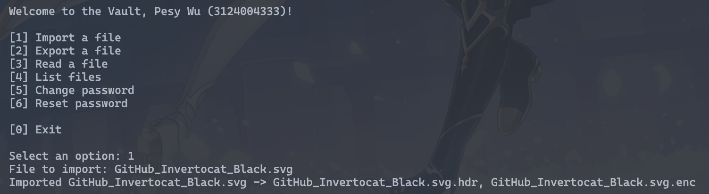
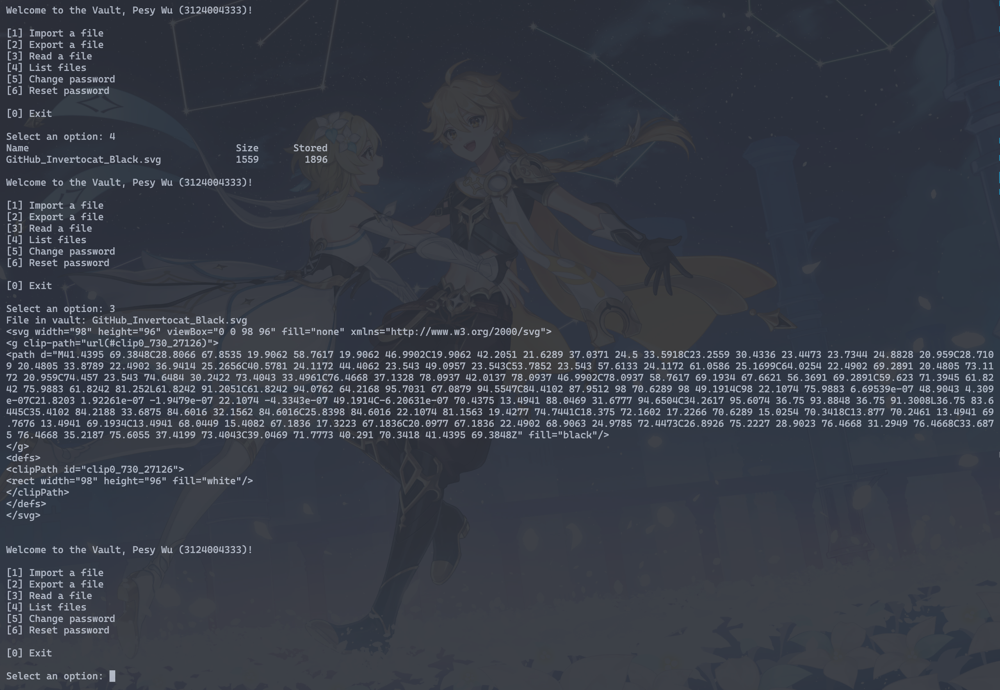
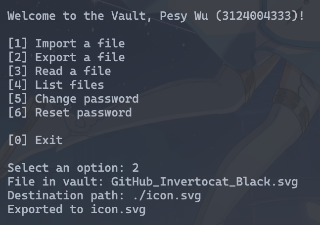
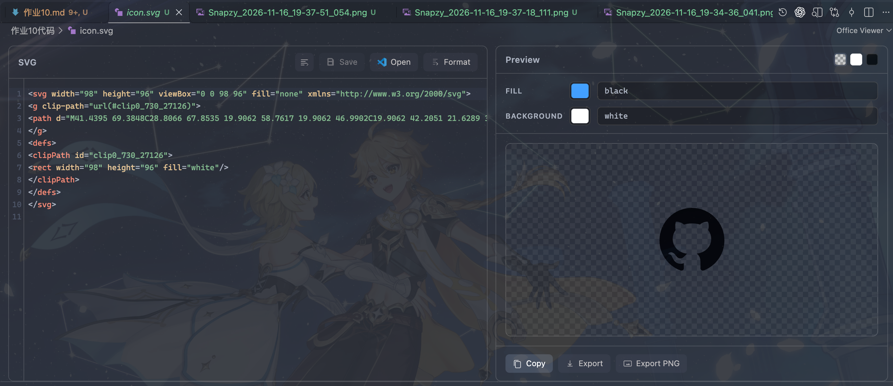

## 第十次密码学作业
11/3/2026

自己选择语言实现一个简单的文件保密系统，可以实现以下功能
1. 可以指定某一个目录用来保存已经加密后的文件。
2. 可以将未加密的文件加密后移动到加密目录内。 （导入）
3. 可以将加密目录内的已加密的文件解密后移到指定的位置 （导出）
4. 初始化时，需要用户输入口令作为初始口令，
5. 用户可以修改口令
6. 用户可以恢复（重置）口令
7. 自己增加其它功能以及对应的UI。
8. 截图时，输出信息的第一行必须是自己的个人信息（比如学号），
9. 设计文档使用md格式保存，文件名为“作业10.md”。

根据自己的能力实现上述功能或增加其它必要的内容。
提示： 数据加密需要使用对称密码算法。 每个数据文件需要使用单独的密钥进行加密，这个密钥可以使用随机数生成器得到。

加密后的文件可以增加一个文件头部，下面是一个加密后文件格式的例子：
```
|文件头部| 原始文件加密后的数据|
```

下面是文件头部的参考
```
struct header{
	int version; // 记录版本信息,该部分内容是否加密保护自己决定
	long file_size; // 记录原始文件长度
	int header_length; // 头部结构的长度
	char[10] crypt_algo; // 对称密码算法字符串，代表使用的某个加密算法
	char[10] hash_algo;  // Hash算法字符串，代表使用的某个Hash算法
	hash_value; // 保存前的数据hash，作为完整性验证数据（可选），
	int file_name_len; // 原始文件名长度
	char* file_name;// 原始文件名内容
	char* key; //  保存加解密密钥数据，具体长度由加密算法决定
}
```

下面是文件字节布局示例
```
+-------------------------------------------------------------------------------------------------------------+
|version|file_size|header_length|crypt_algo|hash_algo|hash_value|file_name_len|file_name|crypt_key|加密后的数据 |
+-------------------------------------------------------------------------------------------------------------+

```

文件的头部需要用用户输入的口令（或口令导出的数据）作为密钥进行加密。 这样的话加密文件用的密钥是初级密码，这个初始密钥被较高一级的密码（比如 口令）进行保护。可以选择这加密后文件内容的Hash值作为文件名。

## 作业

先写了个部分，弄了个大致的思路以后让 AI 补全的

```python
import argparse
import atexit
import os
from hashlib import md5
from pathlib import Path

from Crypto.Cipher import AES
from pydantic import BaseModel

KEY = b"!!!3l240o43E3!!!"
IV = b"!!!3E34o042l3!!!"

argument_parser = argparse.ArgumentParser(description="Vault launcher")
argument_parser.add_argument("--username", type=str, required=True, help="Username for the vault")
argument_parser.add_argument("--password", type=str, required=True, help="Password for the vault")
argument_parser.add_argument("--vault", type=str, required=True, help="Path to the vault directory")
argument_parser.add_argument("--salt", type=str, required=True, help="Salt for password hashing")
argument_parser.add_argument("--init", action="store_true", help="Initialize the vault")

class Cipher(BaseModel):
    @staticmethod
    def encrypt(data: bytes) -> bytes:
        cipher = AES.new(KEY, AES.MODE_CBC, IV)
        return cipher.encrypt(data)

    @staticmethod
    def decrypt(data: bytes) -> bytes:
        cipher = AES.new(KEY, AES.MODE_CBC, IV)
        return cipher.decrypt(data)

class Vault(BaseModel):
    username: str
    password: str
    salt: str
    vault: Path
    filelist: list[str]

    def verify(self, username: str, password: str) -> bool:
        return self.username == username and self.password == md5((password + self.salt).encode()).hexdigest()

    def encrypt(self, data: bytes) -> bytes:
        return Cipher.encrypt(data)
    
    def decrypt(self, data: bytes) -> bytes:
        return Cipher.decrypt(data)
    
    def imp0rt(self, filename: str, data: bytes | None = None, file: Path | None = None) -> Path:
        if not data and not file:
            raise ValueError("Neither data nor file provided to import.")
        with open(self.vault / filename, "wb") as f:
            f.write(Cipher.encrypt(data))
        self.filelist.append(filename)
        return self.vault / filename
    
    def export(self, filename: str, file: Path) -> Path:
        with open(filename, "wb") as f:
            f.write(Cipher.decrypt(file.read_bytes()))
        return Path(filename)
    
    def read(self, filename: str) -> bytes:
        with open(self.vault / filename, "rb") as f:
            return Cipher.decrypt(f.read())

@atexit.register
def cleanup(vault: Vault):
    # Export current vault status to config.json
    config_path = "config.json"
    with open(config_path, "w") as f:
        f.write(vault.model_dump_json())
    

MENU = """
Welcome to the Vault, Pesy Wu (3124004333)!

[1] Import a file
[2] Export a file
[3] Read a file
[4] List files
[5] Change password

[0] Exit
"""

if args := argument_parser.parse_args():
    vault = Vault(
        username=args.username,
        password=md5((args.password + args.salt).encode()).hexdigest(),
        salt=args.salt,
        vault=Path(args.vault),
        filelist=[]
    )
    if args.init:
        vault.vault.mkdir(parents=True, exist_ok=True)
        print(f"Vault initialized at {vault.vault}")
    else:
        with open("config.json", "r") as f:
            config_data = f.read()
            vault_data = Vault.model_validate_json(config_data)
            vault.username = vault_data.username
            vault.password = vault_data.password
            vault.salt = vault_data.salt
            vault.vault = Path(vault_data.vault)
            vault.filelist = vault_data.filelist
        if not vault.verify(args.username, args.password):
            print("Invalid username or password.")
            os._exit(1)
        print(f"Vault accessed at {vault.vault}")


if __name__ == "__main__":
    ...
```





用之前设定好的 arg 进行初始化

```bash
uv run app.py --username 3124004333 --password 3124004333 --vault vault --salt 709358a7b81267d981806015ae0257f344a940bbe6fdabb9cd0e7a1c9002466e --init
```





读取正常



导出也正常



并且文件未损坏


