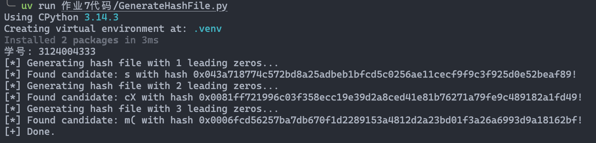
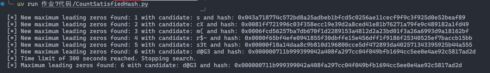
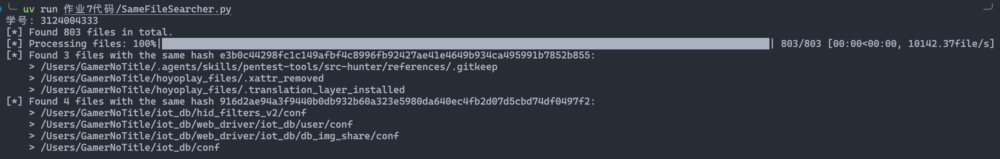

# 作业 7

## 题目

### Hash函数的单向性

利用SHA-256 Hash函数实现下面要求

创建任意一个本文文件，具体内容由自己填写。但要求该文件的hash值满足一定的条件

1. 找出hash值最开始的1位是0的 文本文件内容，并给出在寻找过程中计算hash的次数
2. 找出hash值最开始的连续2位是0的 文本文件内容，并给出在寻找过程中计算hash的次数
3. 找出hash值最开始的连续3位是0的 文本文件内容，并给出在寻找过程中计算hash的次数
4. 给出不超过5分种寻找情况下，可以达到的hash值最多可以是有几位连续0出现，这时的文本内容是什么

### 文件查重

利用SHA-256 Hash函数实现查找本地硬盘重复文件。编程并撰写报告

提示：

1. 首先计算硬盘文件的Hash，并记录文件路径与Hash值的对应关系
2. 利用具有相同Hash值的文件，内容就极其可能相同的特性，查找具有相同Hash值的文件。
3. 可以简单比较一下具有相同Hash值的文件是否长度，部分随机内容相同，如果相同则直接输出，否则说明发生了碰撞。
4. 注意保护个人隐私。
5. 截图时，输出信息的第一行必须是自己的个人信息（比如学号）

编程语言不限，作业文档使用md格式保存信息，文件名为“作业7.md”

## 个人解答

### Hash 函数的单向性

其实跑个脚本暴力找就行



五分钟内找最多前导零也可以用暴力的方法



```
[*] Maximum leading zeros found: 6 with candidate: d@G3 and hash: 0x000000711b999399042a408fa297cc04f049bfb1694cc5ee0e4ae92c5817ad2d
```

### 文件查重

索引一下文件，然后对每个文件 sha256 一下就好了



这里对很多目录进行了排除，都是那种编译缓存和环境之类的东西
