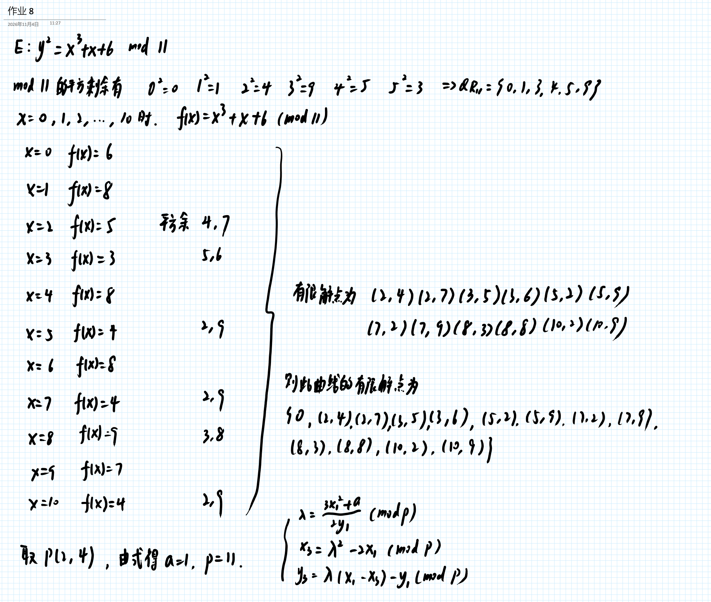
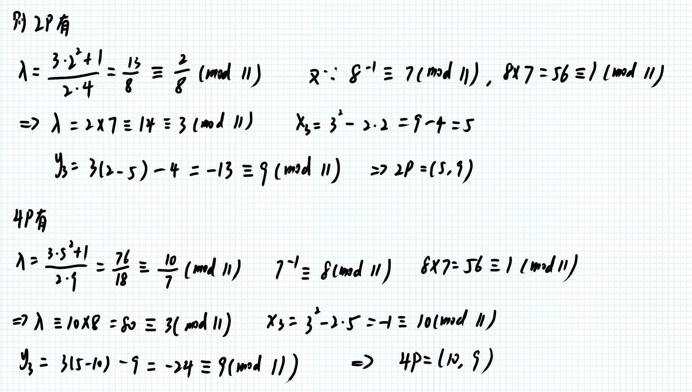

# 作业 9
10/27/2026
1. 网上搜集 PKCS 标准，并给出简单说明。
2. 手工书写，拍照。
	1. 利用穷举法求出椭圆曲线 y^2 = x^3+x+6 mod 11 的所有解点。
	3. 从上一步计算的解点中选择一个非零点P，计算 4P。
	4. 上面的计算需要给出计算过程 。
4. 作业文档使用md格式保存信息，文件名为“作业9.md”。

## 解答

| 标准 | 版本 | 名称 | 简介 |
|---|---:|---|---|
| PKCS #1 | 2.1 | RSA密码编译标准（RSA Cryptography Standard） | 定义了RSA的数理基础、公/私钥格式，以及加/解密、签/验章的流程。1.5版本曾经遭到攻击。 |
| PKCS #2 | - | *弃用* | 原本是用以规范RSA加密摘要的转换方式，现已被纳入PKCS#1之中。 |
| PKCS #3 | 1.4 | DH密钥协议标准（Diffie-Hellman key agreement Standard） | 规范以DH密钥协议为基础的密钥协议标准。其功能，可以让两方透过金议协议，拟定一把会议密钥（Session key）。 |
| PKCS #4 | - | *弃用* | 原本用以规范转换RSA密钥的流程。已被纳入PKCS#1之中。 |
| PKCS #5 | 2.0 | 密码基植加密标准（Password-based Encryption Standard） | 参见RFC 2898与PBKDF2。 |
| PKCS #6 | 1.5 | 证书扩展语法标准（Extended-Certificate Syntax Standard） | 将原本X.509的证书格式标准加以扩展。 |
| PKCS #7 | 1.5 | 密码消息语法标准（Cryptographic Message Syntax Standard） | 参见RFC 2315。规范了以公开密钥基础设施（PKI）所产生之签名/密文之格式。其目的一样是为了拓展数字证书的应用。其中，包含了S/MIME与CMS（Cryptographic Message Syntax）。主要用来存储签名或者加密后的数据，如证书或者CRL。PKCS7可以用二进制的DER格式存储，也可以使用PEM格式存储。Windows中PKCS7通常使用.p7b文件扩展名。 |
| PKCS #8 | 1.2 | 私钥消息表示标准（Private-Key Information Syntax Standard） | Apache读取证书私钥的标准。主要用来存储私钥。私钥首先会使用PKCS #5的标准进行加密，然后Base64编码，转换成为PEM格式存储。 |
| PKCS #9 | 2.0 | 选择属性格式（Selected Attribute Types） | 定义PKCS#6、7、8、10的选择属性格式。 |
| PKCS #10 | 1.7 | 证书申请标准（Certification Request Standard） | 参见RFC 2986。规范了向证书中心申请证书之CSR（certificate signing request）的格式。 |
| PKCS #11 | 2.20 | 密码设备标准界面（Cryptographic Token Interface (Cryptoki)） | 定义了密码设备的应用程序接口（API）之规格。 |
| PKCS #12 | 1.0 | 个人消息交换标准（Personal Information Exchange Syntax Standard） | 定义了包含私钥与公钥证书（public key certificate）的文件格式。私钥采密码（password）保护。PKCS12文件的扩展名是.p12或者.pfx。PKCS12可以看做是PKCS7的扩展，PKCS12可以额外存储私钥。在PKCS12中可以存储证书、私钥、CRL。 |
| PKCS #13 | – | 椭圆曲线密码学标准（Elliptic curve cryptography Standard） | 制定中。规范以椭圆曲线密码学为基础所发展之密码技术应用。椭圆曲线密码学是新的密码学技术，其强度与效率皆比现行以指数运算为基础之密码学算法来的优秀。然而，该算法的应用尚不普及。 |
| PKCS #14 | – | 拟随机数产生器标准（Pseudo-random Number Generation） | 制定中。规范拟随机数产生器的使用与设计。 |
| PKCS #15 | 1.1 | 密码设备消息格式标准（Cryptographic Token Information Format Standard） | 定义了密码设备内部数据的组织结构。 |

Ref: https://zh.wikipedia.org/wiki/%E5%85%AC%E9%92%A5%E5%AF%86%E7%A0%81%E5%AD%A6%E6%A0%87%E5%87%86

